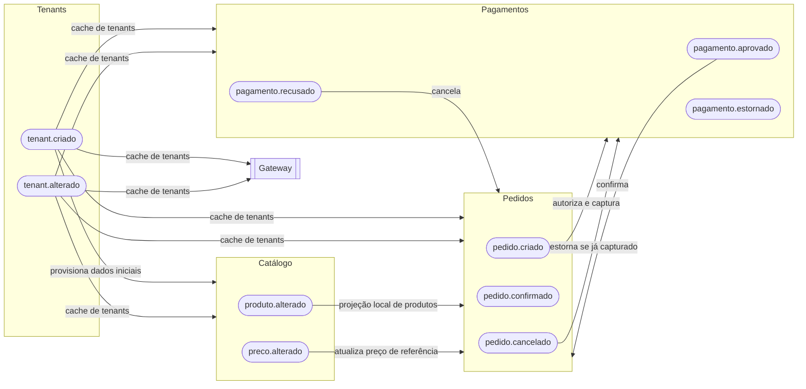
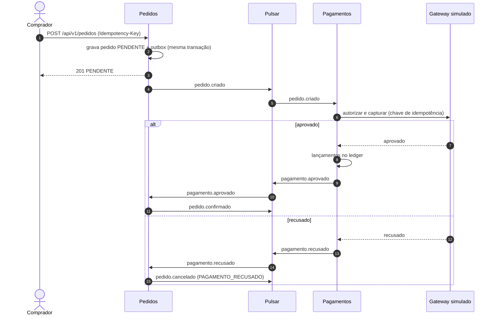
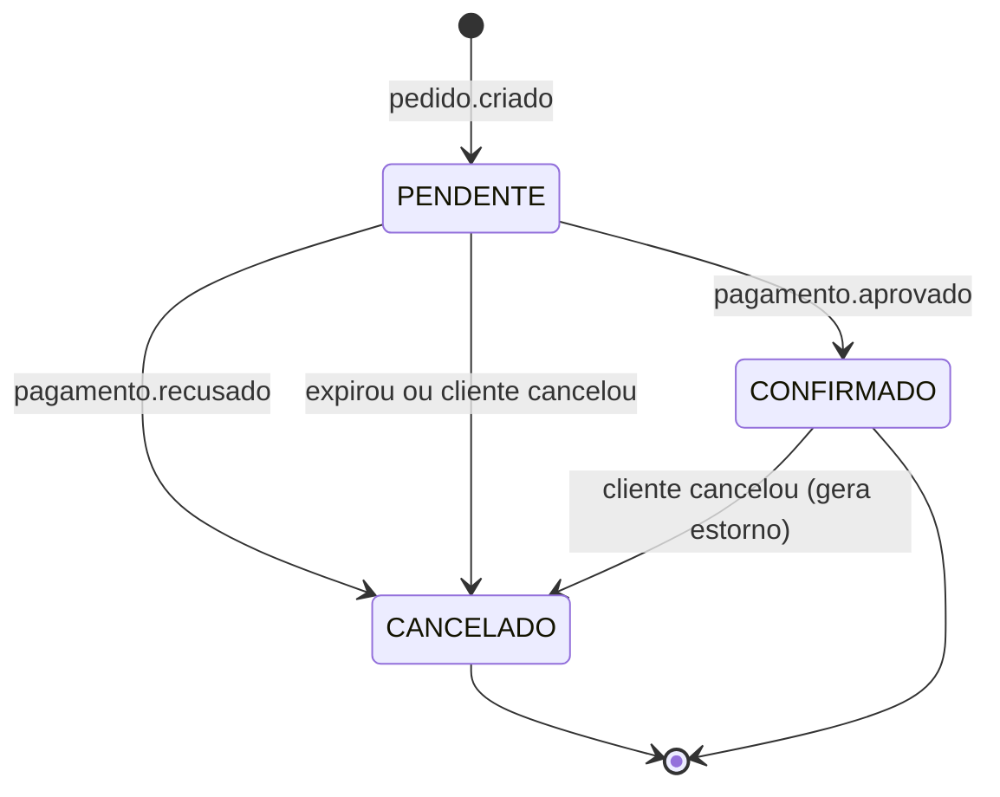

# Event storming: pedidos B2B com pagamentos

Resultado do event storming do Dia 2, no nível de **processo**: os eventos de domínio em ordem, os
comandos que os disparam, quem executa e as políticas ("sempre que X, então Y") que ligam um
contexto ao outro. Os eventos aqui são exatamente os do catálogo em
[`libs/contracts/src/main/avro`](../../libs/contracts/src/main/avro); a página **Arquitetura** do
frontend lê os dois arquivos, então a documentação e o código não se separam.

## Linguagem do domínio

| Termo | Significado |
|---|---|
| Tenant | Empresa que usa a plataforma para vender (um distribuidor, uma indústria). Cada tenant tem seus dados isolados. |
| Cliente | Empresa compradora (B2B) que faz pedidos a um tenant. Existe dentro de um tenant. |
| Plano | O que o tenant contratou: GRATUITO, PROFISSIONAL ou EMPRESARIAL. Define limites de uso (rate limit, volume). |
| Nível de isolamento | Pool (coleções compartilhadas), Bridge (database e namespace próprios) ou Silo (instância própria). |
| Pedido | Compra de um cliente. Nasce PENDENTE e termina CONFIRMADO ou CANCELADO. |
| Pagamento | Cobrança de um pedido no gateway simulado: autorização e captura em um passo. |
| Estorno | Devolução de um pagamento capturado, quando o pedido é cancelado depois da captura. |
| Ledger | Livro contábil do tenant em partidas dobradas: lançamentos imutáveis; o saldo é derivado. |
| Chave de idempotência | Identificador de uma operação; repetir com a mesma chave não cobra duas vezes. |

## Contextos e eventos

Cada contexto é um microsserviço com seu MongoDB. As setas são eventos no Pulsar.

## Linha do tempo do pedido

Os eventos em ordem, com o comando que os causa e a política que reage a eles.

| # | Ator / política | Comando | Contexto | Evento |
|---|---|---|---|---|
| 1 | Administrador da plataforma | Cadastrar tenant | Tenants | `tenant.criado` |
| 1b | Política: "tenant criado ou alterado → atualizar cache" | Atualizar catálogo de tenants | Gateway e todos os serviços | (interno) |
| 2 | Política: "tenant criado ou alterado → copiar plano e situação" (ADR-0010) | Atualizar cópia local do tenant | Catálogo | (interno) |
| 3 | Gestor do tenant; política "limite do plano" e "tenant suspenso não escreve" | Cadastrar produto / alterar preço | Catálogo | `produto.alterado`, `preco.alterado` |
| 3b | Política: "produto ou preço alterado → copiar" (ADR-0011) | Atualizar cópia local do produto | Pedidos | (interno) |
| 4 | Comprador (cliente B2B); políticas "preço da cópia local" e "mesma Idempotency-Key, mesmo pedido" (ADR-0011) | Fazer pedido | Pedidos | `pedido.criado` |
| 5 | Política: "pedido criado → cobrar" | Autorizar e capturar | Pagamentos | `pagamento.aprovado` ou `pagamento.recusado` |
| 6a | Política: "pagamento aprovado → confirmar" | Confirmar pedido | Pedidos | `pedido.confirmado` |
| 6b | Política: "pagamento recusado → cancelar" | Cancelar pedido | Pedidos | `pedido.cancelado` |
| 6c | Job de expiração (pedido PENDENTE há mais de 15 min) | Expirar pedido | Pedidos | `pedido.cancelado` (EXPIRADO) |
| 7 | Comprador | Cancelar pedido confirmado | Pedidos | `pedido.cancelado` |
| 8 | Política: "pedido cancelado após captura → estornar" | Estornar | Pagamentos | `pagamento.estornado` |

## Saga do pedido

Saga **coreografada**: não há orquestrador; cada serviço reage aos eventos do outro. O estado do
pedido muda só no serviço de Pedidos, e o dinheiro só no de Pagamentos.

## Estados do pedido

## Pontos de atenção (hot spots)

- **Pagamento duplicado.** `pedido.criado` pode chegar duas vezes (reentrega do Pulsar). A chave de
  idempotência do pagamento é derivada do `pedidoId`, com índice único no MongoDB de Pagamentos.
- **Ordem dos eventos.** Dentro de um tópico, a chave `tenantId:pedidoId` com assinatura
  `Key_Shared` garante a ordem dos eventos do mesmo pedido. **Entre tópicos não há ordem**:
  `pedido.cancelado` pode chegar a Pagamentos antes de `pedido.criado`. Pagamentos guarda a marca
  de cancelamento por pedido e nunca cobra um pedido já cancelado. Se o cancelamento chegar durante
  a captura, o índice único por pedido faz uma das transações abortar e ser refeita: a cobrança
  vencedora é estornada, ou a marca vencedora impede a cobrança (ADR-0006, ADR-0012).
- **Cancelamento concorrente com a aprovação.** O cliente cancela enquanto o pagamento está sendo
  capturado. Pedidos ignora `pagamento.aprovado` de um pedido já CANCELADO; quem devolve o dinheiro
  é Pagamentos, que estorna ao receber o `pedido.cancelado` de um pedido com pagamento APROVADO.
- **Pedido esquecido.** Um pedido PENDENTE sem resposta de pagamento por 15 minutos é expirado por
  um job de Pedidos (`EXPIRADO`); se o pagamento aprovar depois, Pagamentos estorna.
- **Pedido em nome de outro cliente.** O cliente vem do token (`X-Cliente-Id`), nunca do corpo
  (ADR-0007).
- **Preço mudou durante o pedido.** O pedido guarda o preço unitário no momento da criação
  (`precoUnitarioCentavos`); `preco.alterado` só afeta pedidos novos.
- **Tenant suspenso ou promovido.** `tenant.alterado` chega ao gateway e a todos os serviços. Com
  `ativo = false` o gateway recusa requisições do tenant (Dia 4); pedidos em andamento terminam
  normalmente. Mudança de nível (Pool → Bridge) atualiza o roteamento de dados (Dia 9).
